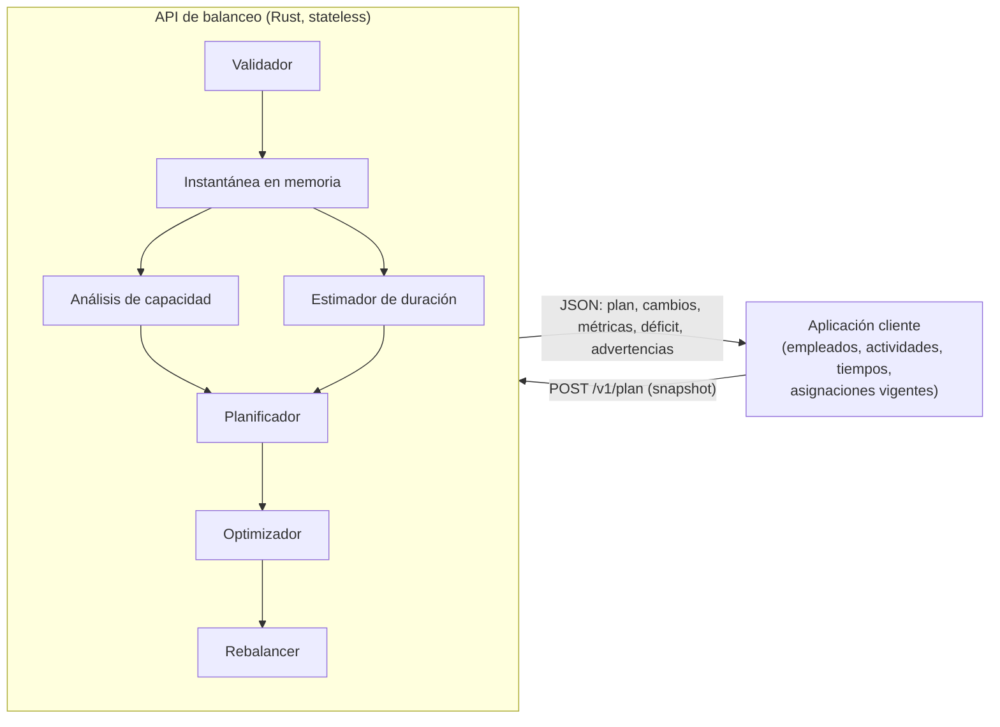

# 03 — Arquitectura lógica

## Principio: servicio sin estado

La API de balanceo es un servicio HTTP **stateless**. No tiene base de datos
propia ni estado operativo persistente. Todo lo necesario para un cálculo llega en
la petición (`POST /v1/plan`) y se devuelve como respuesta JSON.

Puede conservar logs técnicos y métricas de operación, pero **no** la cola de
actividades, las asignaciones vigentes ni el historial de tiempos como parte de su
funcionamiento.

## Vista general

## Módulos y responsabilidades

Los módulos operan **sobre la instantánea de entrada**, no sobre una base de datos
propia.

| Módulo | Responsabilidad |
|---|---|
| `task_store` | Representación en memoria de las actividades recibidas |
| `employee_registry` | Representación en memoria de empleados, habilidades y turnos |
| `duration_estimator` | Uso de las duraciones enviadas (y predicción restante) |
| `capacity_estimator` | Capacidad efectiva por horizonte a partir del snapshot |
| `demand_forecaster` | Proyección de demanda entrante (opcional; si el cliente aporta datos) |
| `feasibility_analyzer` | Identificación y cuantificación de insuficiencia |
| `scheduler` | Generación de una asignación inicial |
| `optimizer` | Mejora de la distribución (búsqueda local o solver externo) |
| `rebalancer` | Decide qué actividades pendientes mover frente a las asignaciones actuales |
| `assignment_manager` | Produce los cambios propuestos de forma consistente |
| `metrics` | Métricas de la respuesta y calidad de predicción (efímeras) |

## Flujo de una petición

1. **Validar** la petición (contrato JSON, tipos, restricciones básicas).
2. **Construir la instantánea** en memoria (empleados, tareas, asignaciones,
   duraciones, horizonte).
3. **Análisis de capacidad**: factibilidad, déficit, `UNASSIGNABLE`.
4. **Planificación + optimización**: asignación inicial y mejora local.
5. **Rebalanceo**: comparar contra las asignaciones actuales y generar cambios.
6. **Respuesta**: plan completo, cambios, métricas, déficit y estado.

## Acoplamientos a evitar

- El `duration_estimator` no debe estar acoplado al `optimizer`.
- El `feasibility_analyzer` es independiente del optimizador.
- El `optimizer` puede delegar a un solver externo (HiGHS) sin cambiar el resto.
  Ver [`12-rust-y-solucionador.md`](12-rust-y-solucionador.md).
