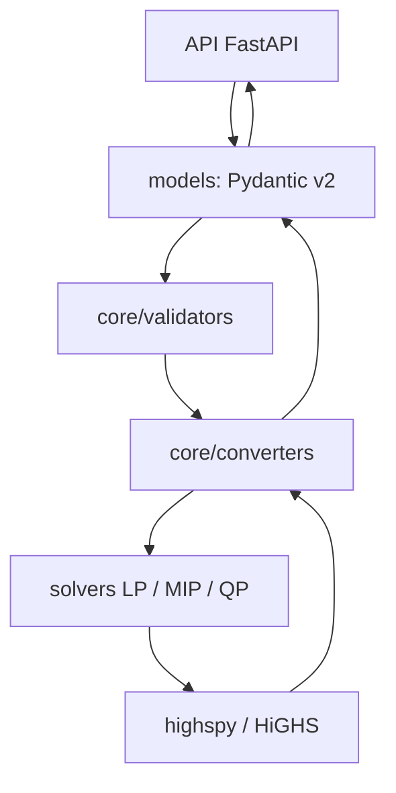
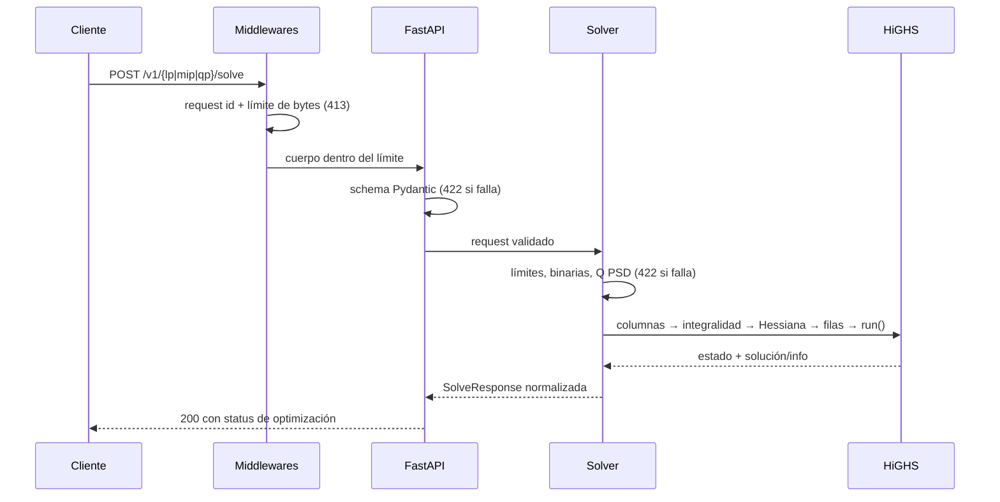

# Arquitectura del motor `highs`

## Visión general

- `models/` — tipos públicos, validación estructural y schemas request/response.
- `api/` — rutas HTTP, códigos de estado, serialización y errores uniformes.
- `core/validators.py` — validaciones semánticas y límites de recursos.
- `core/converters.py` — conversión a estructuras de `highspy` y normalización de
  resultados. Ningún tipo de `highspy` sale de este módulo hacia la respuesta HTTP.
- `solvers/` — orquestación específica por tipo de problema; no dependen de HTTP.
- `config.py` — configuración validada desde variables `HIGHS_`.

## Ciclo de vida de un request

Nota: un modelo infactible o no acotado no es un error de la API; llega con
HTTP 200 y `status="infeasible"` o `"unbounded"`.

## Estados del motor y contrato público

El mapeo es una tabla explícita de `HighsModelStatus` (nunca comparación de
texto); está cubierta por tests para todos los miembros del enum de la versión
fijada:

| HighsModelStatus | estado público |
|---|---|
| `kOptimal` | `optimal` |
| `kInfeasible` | `infeasible` |
| `kUnbounded` | `unbounded` |
| `kUnboundedOrInfeasible` | `unbounded_or_infeasible` |
| `kTimeLimit` | `time_limit` |
| `kIterationLimit` | `iteration_limit` |
| `kSolutionLimit` | `solution_limit` |
| `kObjectiveBound` / `kObjectiveTarget` | `objective_bound` / `objective_target` |
| `kInterrupt` / `kHighsInterrupt` | `interrupted` |
| `kMemoryLimit` | `memory_limit` |
| `kNotset`, `kUnknown`, `kModelEmpty` | `unknown` |
| `kLoadError`, `kModelError`, `kPresolveError`, `kSolveError`, `kPostsolveError` | error controlado `SOLVER_ERROR` (HTTP 500) |

Extracción de resultados: `variables` y `objective_value` se incluyen solo
cuando el motor marca la solución como válida **y** el estado puede portar una
solución (óptimo o incumbente bajo límite: `time_limit`, `iteration_limit`,
`solution_limit`, `objective_bound/objective_target`, `interrupted`). Los
duales y costos reducidos se devuelven solo para LP/QP con `dual_valid=True`.
Los valores no finitos del motor (`inf`, `-inf`, `NaN`, centinelas como
`mip_node_count=-1`) se transforman en `null`; ninguna respuesta JSON contiene
infinitos ni NaN.

## Límites y errores

| HTTP | Código | Uso |
|---|---|---|
| `413` | `REQUEST_TOO_LARGE` | Cuerpo mayor a `HIGHS_MAX_REQUEST_BYTES` (se comprueba antes de parsear). |
| `422` | `VALIDATION_ERROR` | Schema, dimensiones, cotas, integralidad, Q no simétrica/PSD, límites de recursos u opciones. |
| `500` | `SOLVER_ERROR` | El motor rechazó una operación sobre el modelo. |
| `500` | `INTERNAL_ERROR` | Fallo inesperado; el detalle queda en logs, nunca en la respuesta. |

Límites de recursos (publicados en `/v1/capabilities`):
`max_variables`, `max_constraints`, `max_matrix_elements` (coeficientes no nulos
de la matriz de restricciones), `max_qp_variables`, `max_request_bytes` y
`max_time_limit_seconds`. `threads: 0`/omitido se resuelve al máximo
configurado (`HIGHS_MAX_THREADS`) para evitar consumo de CPU ilimitado.

Un request puede correr hasta `time_limit`; el proceso es síncrono y cada
request crea su propia instancia de `Highs` (sin estado compartido). La
concurrencia se limita en despliegue (workers/proxy): un timeout HTTP externo
no reemplaza al `time_limit` del solver, controlan cosas distintas.

## ¿Por qué rutas por tipo de problema y no por algoritmo?

`/lp/solve`, `/mip/solve` y `/qp/solve` describen el problema del cliente, no
la implementación interna. Los mismos problemas se resuelven con distintos
algoritmos (simplex, IPM, branch-and-bound, active-set); exponer `/simplex` o
`/branch-and-bound` acoplaría el contrato público a decisiones que HiGHS puede
cambiar entre versiones. `metadata.solver_used` informa de forma normalizada
(`simplex`, `ipm`, `auto`, `mip`, `qpasm`) sin prometer todos los detalles
internos del motor.

## Matriz de restricciones y Hessiana

El contrato recibe vectores densos; la conversión almacena solo coeficientes no
nulos (se omiten ceros exactos, sin umbral de sparsificación que alteraría el
modelo). Las filas se pasan en formato disperso por filas. La Hessiana QP se
valida (simetría y PSD), se extrae su mitad triangular inferior en formato CSC
y se pasa con `passHessian(n, nnz, HessianFormat.kTriangular, start, index,
value)`; `solver="qp"` no se usa nunca porque no es una opción válida en la
versión fijada.
